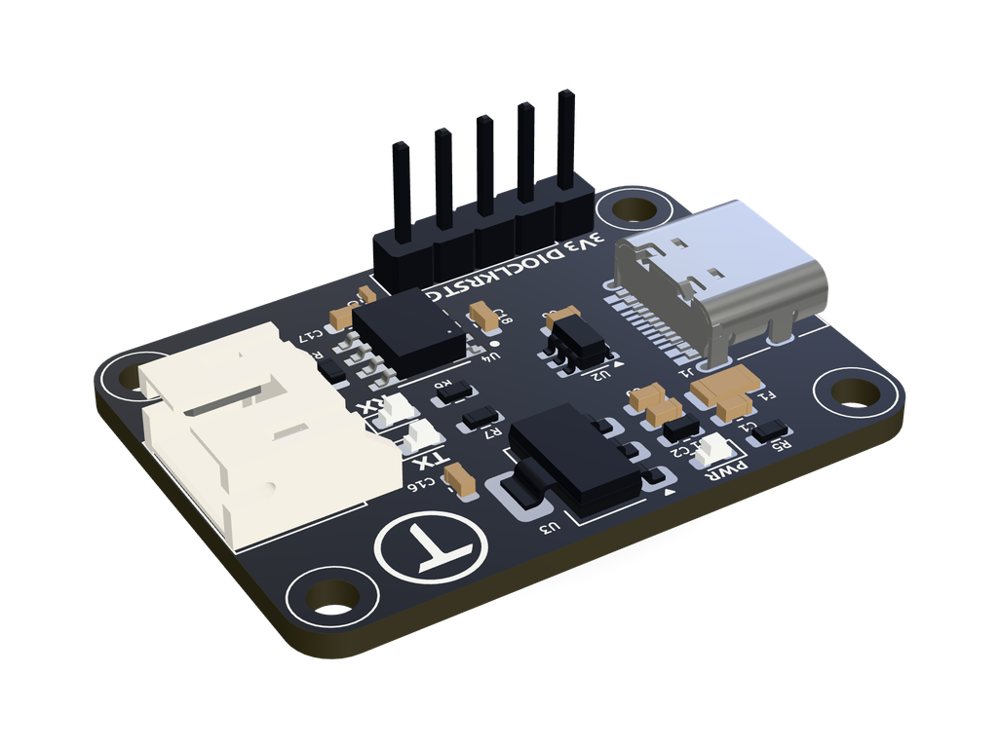
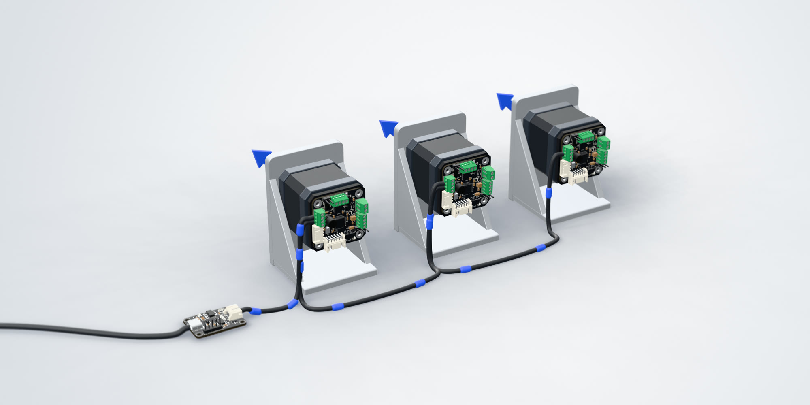
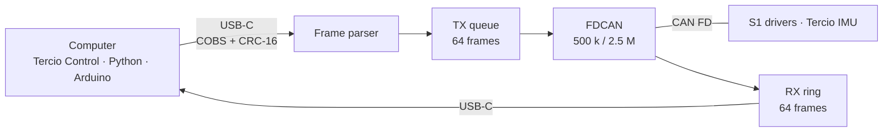

<div align="center">



# Tercio FD

**USB-C to CAN FD, for the Tercio bus.**

The adapter between your computer and your Tercio S1 drivers and Tercio IMUs.<br>
A standard USB serial port on one side, CAN FD at 2.5 Mbit/s on the other, and every byte checked in between.

[Website](https://terciolabs.com/products/tercio-fd) ·
[Documentation](https://docs.terciolabs.com/fd/overview/) ·
[Tercio Control](https://control.terciolabs.com) ·
[Serial protocol](#serial-protocol)


</div>

---

## Why

A CAN bus has no place to plug in a laptop. You need an adapter, and the adapter decides how much you can trust what you see. Most cheap ones speak a text protocol over serial: a lost or flipped byte becomes a wrong frame on the bus, and a full buffer loses frames without telling anyone.

The Tercio FD is built the other way round. Every frame over USB is COBS-encoded and carries a CRC, so damage is caught and counted, never sent on. When the bus is busier than the host, the adapter pushes back over USB instead of dropping data. And four times a second it tells you how the bus is doing.

## Highlights

| | |
|---|---|
| **No drivers** | A standard USB serial device (CDC) on Windows 10+, macOS and Linux, and in Chrome or Edge through Web Serial. |
| **Checks every byte** | COBS framing with a CRC-16 on every frame. A glitch is dropped and counted, and the next frame boundary resynchronises the stream. |
| **Never drops silently** | 64 frames of buffer each way and USB flow control towards the host. Every frame it does drop is counted, by direction. |
| **Reports the bus** | Bus state, error counters, the last protocol error, traffic and drops, every 250 ms while a program holds the port open. |
| **Updates over USB** | One command restarts it into ST's USB bootloader. If an update goes wrong, it enters the bootloader by itself. |
| **Protocol-agnostic** | It forwards frames without interpreting them, so anything that speaks the [Tercio CAN protocol](https://docs.terciolabs.com/protocol/can/) works through it. |

## How it works





- **Host to bus.** The parser checks each frame's COBS encoding, CRC and CAN ID, then queues it for the bus. While the queue is full, bytes wait in the USB receive buffer and the USB stack holds the host off, so nothing is lost. A frame the bus has not accepted within 50 ms of arriving (no node listening, for example) is dropped and counted.
- **Bus to host.** The FDCAN interrupt fills a 64-frame ring. Frames go to the host whole or not at all; if the host stops reading, the ring fills and the overflow is counted. With no program holding the port open, frames are discarded.
- **Session start.** When a program opens the port, the adapter introduces itself with its info frame first, so the host knows where its session begins.
- **Clocks.** The core runs from the 16 MHz crystal, checked against the internal oscillator at start-up, with a fallback if it is missing. USB runs from the internal 48 MHz oscillator, trimmed continuously to the host's start-of-frame.
- **One loop, no blocking.** A single cooperative main loop with a 500 ms watchdog. No third-party libraries: the STM32duino core and ST's HAL only, pinned to the same versions as the Tercio S1 firmware.

## Specifications

| | |
|---|---|
| **Host** | USB-C, USB 2.0 full speed, CDC serial; VID:PID `1209:0011`, product `tercioFD` |
| **Bus** | CAN FD with bit-rate switching, 500 kbit/s arbitration and 2.5 Mbit/s data, 11-bit IDs |
| **Transceiver** | Microchip MCP2562FD |
| **Termination** | 120 Ω on board, always on: the adapter sits at one end of the bus |
| **Buffers** | 64 frames each way; frames not delivered within 50 ms are dropped and counted |
| **Protection** | ESD protection on USB and on the CAN lines |
| **Processor** | STM32G431, Arm Cortex-M4F at 170 MHz, 16 MHz crystal |
| **Connectors** | USB-C; JST XH 3-pin for the bus (CAN-H, CAN-L, GND); 5-pin SWD header |
| **LEDs** | PWR (USB power), RX (every frame on the bus), TX (frames from the computer) |
| **Power** | From USB. The adapter does not power the bus or the drivers. |
| **Board** | 35 × 25 mm, four 2.5 mm holes on 30 × 20 mm centres |

## Quick start

1. **Wire the bus.** CAN-H, CAN-L and GND from the adapter's JST XH connector to the first node, then on from node to node. The adapter terminates its end; terminate the far end on the last S1 ([wiring guide](https://docs.terciolabs.com/s1/wiring/)).
2. **Plug in USB-C.** The adapter shows up as a serial port. No driver to install.
3. **Open [Tercio Control](https://control.terciolabs.com)** in Chrome or Edge and select **Connect**. It lists every node on the bus and shows the adapter's bus health.

### Python

```python
from TercioBridge import Bus

with Bus("COM5") as bus:            # or "/dev/ttyACM0", "/dev/cu.usbmodem…"
    print(bus.adapter_info())       # firmware, hardware revision, clock, unique ID
    for node in bus.discover():     # every S1 and IMU on the bus
        print(node)
    print(bus.adapter_status())     # bus state, error counters, traffic, drops
```

The Python and Arduino libraries are in the [Tercio S1 repository](https://github.com/Kerol-Dev/Tercio-s1/tree/main/Firmware/Libraries).

## Serial protocol

Both directions use the same packets, sent as a byte stream over the USB serial port. The baud rate setting is ignored.

```text
packet  = [id u16 LE] [opcode u8] [payload 0–63 bytes] [crc16 u16 LE]
on wire = COBS(packet) 0x00
```

- **COBS** removes every zero byte from the packet, so `0x00` only ever marks a frame boundary. After any corruption, the next delimiter resynchronises the stream.
- **CRC** is CRC-16/CCITT-FALSE (poly `0x1021`, init `0xFFFF`) over id, opcode and payload. Check value: `"123456789"` → `0x29B1`.
- **A CAN frame** maps to a packet as id = CAN ID, opcode = data[0], payload = data[1…]. On the bus, frames are padded up to the next valid CAN FD length.
- **id `0x800`**, outside the 11-bit range, addresses the adapter itself.

The contract is [`Firmware/src/bridge/Framing.h`](Firmware/src/bridge/Framing.h) and [`AdapterProtocol.h`](Firmware/src/bridge/AdapterProtocol.h). Full reference: [Serial link](https://docs.terciolabs.com/protocol/serial/).

### The adapter channel (id `0x800`)

| Opcode | Request | Reply |
|---|---|---|
| `0x00` | GetInfo | Info, 20 bytes. Also sent unprompted when a program opens the port. |
| `0x01` | GetStatus | Status, 28 bytes. Also sent every 250 ms while the port is open. |
| `0x02` | ResetCounters | Status, after the reset |
| `0x03` | EnterBootloader | Empty; 50 ms later the adapter restarts into ST's USB DFU bootloader |

**Info** (20 bytes): protocol version (`1`), firmware major, minor and patch, hardware revision, flags (bit 0: running from the crystal; bit 1: boot pin ignored, as it should be), 2 reserved bytes, the 12-byte unique ID.

**Status** (28 bytes):

| Offset | Field | Type | |
|---|---|---|---|
| 0 | bus state | u8 | 0 error-active, 1 warning, 2 error-passive, 3 bus-off |
| 1 | TEC | u8 | transmit error counter |
| 2 | REC | u8 | receive error counter |
| 3 | last error | u8 | last protocol error code (FDCAN PSR.LEC) |
| 4 | to CAN | u32 | frames delivered to the bus |
| 8 | from CAN | u32 | frames received from the bus |
| 12 | dropped to CAN | u32 | queue full, or not delivered within 50 ms |
| 16 | dropped from CAN | u32 | the host did not read fast enough |
| 20 | framing errors | u32 | damaged packets from the host (COBS, CRC or ID) |
| 24 | bus-off events | u16 | |
| 26 | reserved | u16 | |

How to read these: [Bus health](https://docs.terciolabs.com/fd/bus-health/).

## Firmware

```bash
cd Firmware
pio run                  # build: .pio/build/tercio_fd/firmware.bin
pio test -e native       # host unit tests: CRC, COBS, resync, corruption, layouts
```

### Update over USB

Select **Restart into update mode** on the adapter page in Tercio Control, or call `bus.enter_adapter_bootloader()` from Python. The adapter reappears as *STM32 BOOTLOADER* (`0483:df11`). Then:

```bash
dfu-util -a 0 -s 0x08000000:leave -D .pio/build/tercio_fd/firmware.bin
```

STM32CubeProgrammer over USB works too. On Windows, dfu-util needs the WinUSB driver for the bootloader device, installed once with [Zadig](https://zadig.akeo.ie/).

**If an update goes wrong:** when the firmware fails to start three times in a row (a reset before it has run for two seconds), the adapter enters the USB bootloader by itself. Unplug and replug it up to three times, then flash again.

### First flash of a new board

A blank board is flashed over SWD (J3) with an ST-Link:

```bash
pio run -t upload
```

The CAN receive pin is also the chip's BOOT0 pin, and an idle bus holds it high, which would start ST's bootloader instead of the firmware. The firmware fixes that itself on first run: it sets the option bytes `nSWBOOT0 = 0`, `nBOOT0 = 1` and resets once. To set them beforehand:

```bash
STM32_Programmer_CLI -c port=SWD -ob nSWBOOT0=0 nBOOT0=1
```

Tercio Control's adapter page then shows **Boot pin: Ignored, as it should be**.

## Repository layout

```text
Firmware/
├── src/
│   ├── board/        pins, clock (crystal checked against HSI), boot options and DFU entry, NMI
│   ├── bridge/       USB <-> CAN bridge, serial framing, adapter channel
│   ├── drivers/      CAN FD: timing, TX queue, RX ring, bus status
│   └── main.cpp
├── test/             host unit tests
└── platformio.ini
```

## Coming from the first firmware

Firmware 1 used a different serial framing, which current Tercio Control and the libraries no longer speak. Flash firmware 2 once over SWD as above; after that, updates go over USB.

## License

The firmware is licensed under an MIT-style licence **with a non-commercial restriction**: free for personal, educational and other non-commercial use; commercial use needs written permission. See [LICENSE](LICENSE).

<div align="center">
<sub>Made by <a href="https://terciolabs.com">Tercio Labs</a></sub>
</div>
